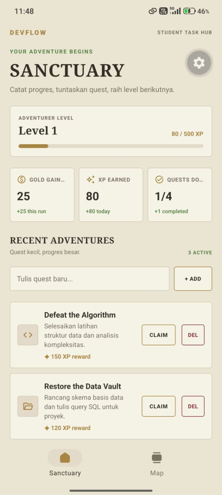
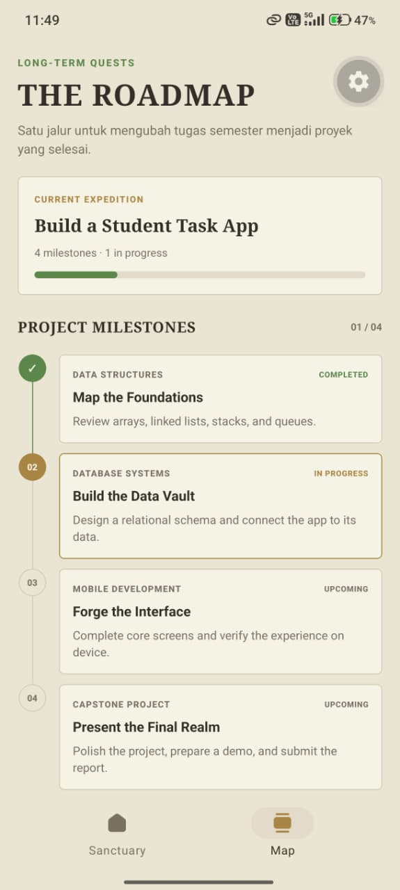

# Student Task — DevFlow

## Identitas Mahasiswa

| Informasi   | Isi                        |
| ----------- | -------------------------- |
| Nama        | **[Isi nama]**             |
| NIM         | **[Isi NIM]**              |
| Kelas       | **[Isi kelas]**            |
| Mata Kuliah | **[Isi nama mata kuliah]** |

## Screenshot Aplikasi

Screenshot aplikasi berikut ditampilkan berdampingan menggunakan gambar yang tersimpan di `src/screenshot/`.

<table>
  <tr>
    <td align="center"></td>
    <td align="center"></td>
  </tr>
  <tr>
    <td align="center">Dashboard / Sanctuary</td>
    <td align="center">Project Roadmap / Map</td>
  </tr>
</table>

## Tentang Aplikasi

**DevFlow — Student Task Hub** adalah aplikasi produktivitas untuk membantu mahasiswa, mencatat dan mengelola tugas kuliah maupun proyek. Tugas disajikan sebagai quest dengan tema RPG fantasi. Pengguna dapat menambahkan quest, menandai quest selesai untuk memperoleh XP, menghapus quest, melihat ringkasan progres, dan memantau milestone proyek melalui roadmap.

Data quest disimpan sementara di state aplikasi, bukan di database. Setelah aplikasi dimuat ulang, daftar kembali ke data contoh awal.

## Tech Stack

- **React Native** untuk membangun antarmuka aplikasi lintas platform.
- **Expo SDK 58** untuk runtime dan tool pengembangan.
- **Expo Router** untuk navigasi berbasis file dan tab.
- **TypeScript** untuk tipe data dan pemeriksaan statis.
- **React Hooks** (`useState`, `useEffect`, dan custom hook `useTaskFilter`) untuk mengelola state serta memfilter quest.
- **React Native StyleSheet** untuk styling antarmuka.
- **Expo Symbols** untuk ikon lintas platform.

## Tips Menjalankan Aplikasi

1. Pastikan Node.js versi yang didukung Expo SDK 58 sudah terpasang, lalu jalankan `npm install` dari folder proyek.
2. Jalankan `npx expo start` untuk membuka development server.
3. Gunakan QR code dengan Expo Go, atau tekan `w` untuk membuka aplikasi versi web. Untuk Android/iOS, pilih emulator atau perangkat yang tersedia dari development server.
4. Jika port default sedang dipakai, pilih port lain yang ditawarkan Expo.

Pemeriksaan proyek: `npm run lint` dan `npx tsc --noEmit`.
